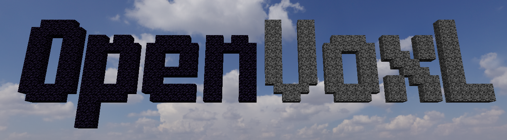

# OpenVoxL (WIP)



**This repository is an improved version of one of my previous projects developed during my computer science studies, when I was first learning 3D programming with OpenGL. This updated version aims to provide cleaner and more maintainable code, as well as additional features.**

### How to compile

```bash
# Run these commands from the root directory
mkdir build
cd build
cmake ..
make
./openvoxl # Run
```

### Requirements

+ C++17
+ CMake >= 3.10
+ OpenGL >= 4.3
+ GLAD, GLFW, GLM and ImGui are already included in [external](external)

### Controls

+ **W/A/S/D :** Move the camera forward/backward/left/right
+ **Spacebar/Left Ctrl :** Move the camera up/down
+ **Mouse :** Look around
+ **Left Click :** Break a block
+ **Right Click :** Place a block
+ **Mouse Wheel :** Move the selection in the hotbar
+ **+/- :** Navigate through the available blocks in the hotbar
+ **E :** Switch between MouseFree and KeyFree camera
+ **F :** Switch between Block and Structure placing mode
+ **O :** Switch to Orbital camera
+ **P :** Switch to Player
+ **Q :** Show/Hide the HUD
+ **F3 :** Show/Hide the Debug window
+ **Escape :** Close the window

### Demo videos

<table align="center">
  <tr>
    <td align="center" width="250">
      <a href="https://www.youtube.com/watch?v=aOq84dPkSeA">
        
      </a>
      <br>
      <strong>Skybox, Camera and Face Culling</strong>
    </td>
    <td align="center" width="250">
      <a href="https://www.youtube.com/watch?v=mNM1NbJVsNA">
        
      </a>
      <br>
      <strong>Flat, Full, Wave and Cheese Chunks</strong>
    </td>
    <td align="center" width="250">
      <a href="https://www.youtube.com/watch?v=uEHOm_V1WbA">
        
      </a>
      <br>
      <strong>Terrain Heightmap Generation</strong>
    </td>
  </tr>
  <tr>
    <td align="center" width="250">
      <a href="https://www.youtube.com/watch?v=R8XOiZG2jFE">
        
      </a>
      <br>
      <strong>Terrain Generation with Splines</strong>
    </td>
    <td align="center" width="250">
      <a href="https://www.youtube.com/watch?v=4UpIf9l_4X0">
        
      </a>
      <br>
      <strong>Player, Collision and Hotbar</strong>
    </td>
  </tr>
</table>

<!--
### Debug window
-->
